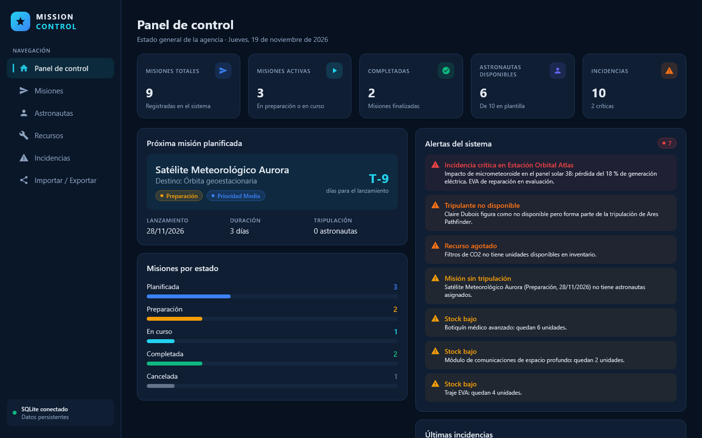
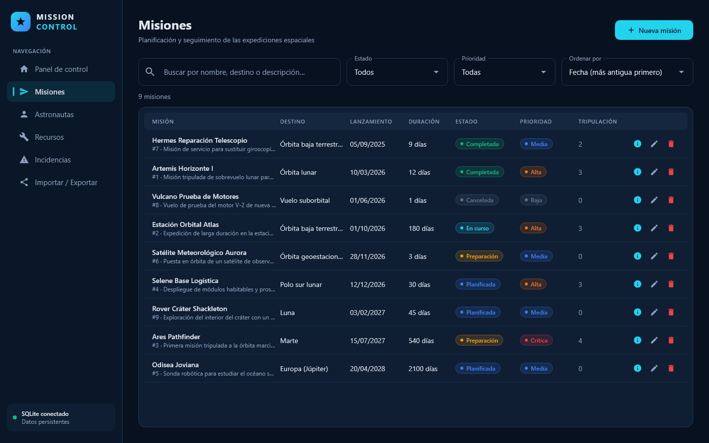
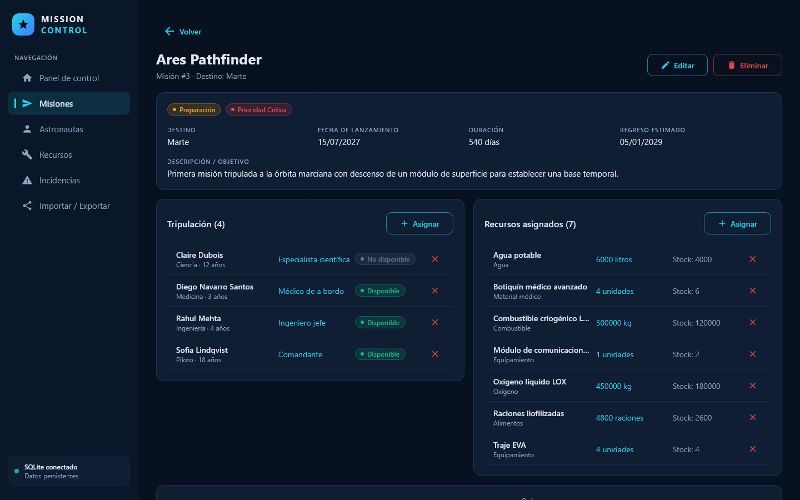
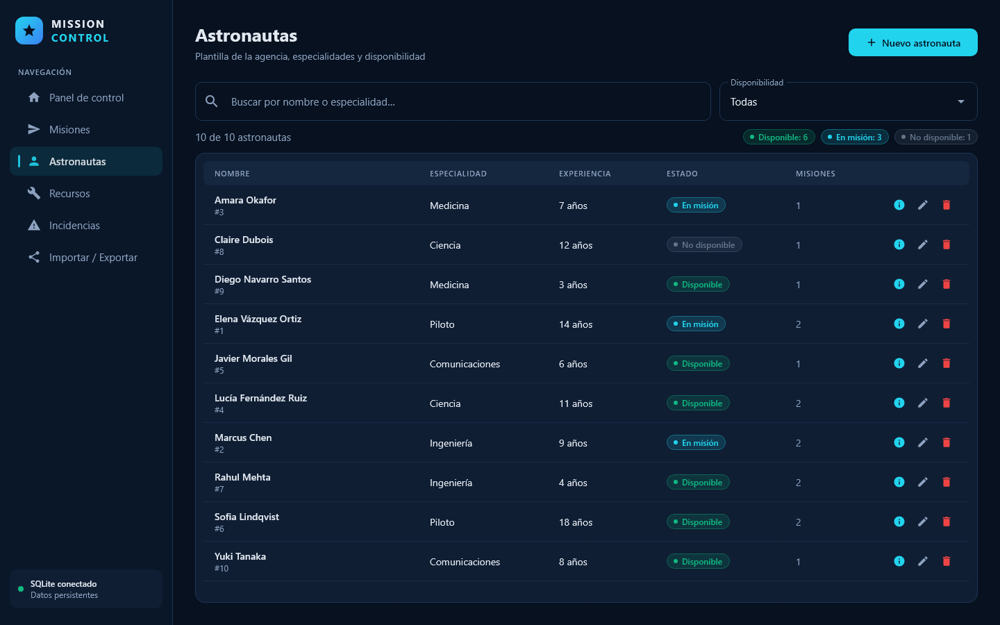
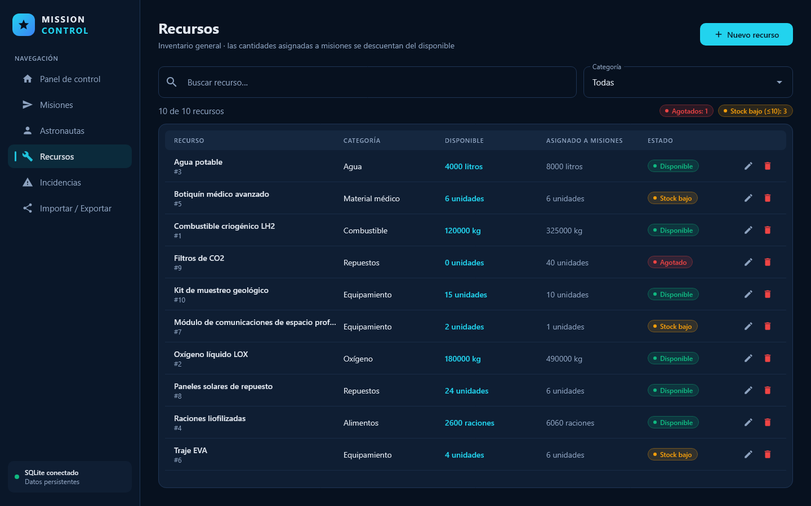
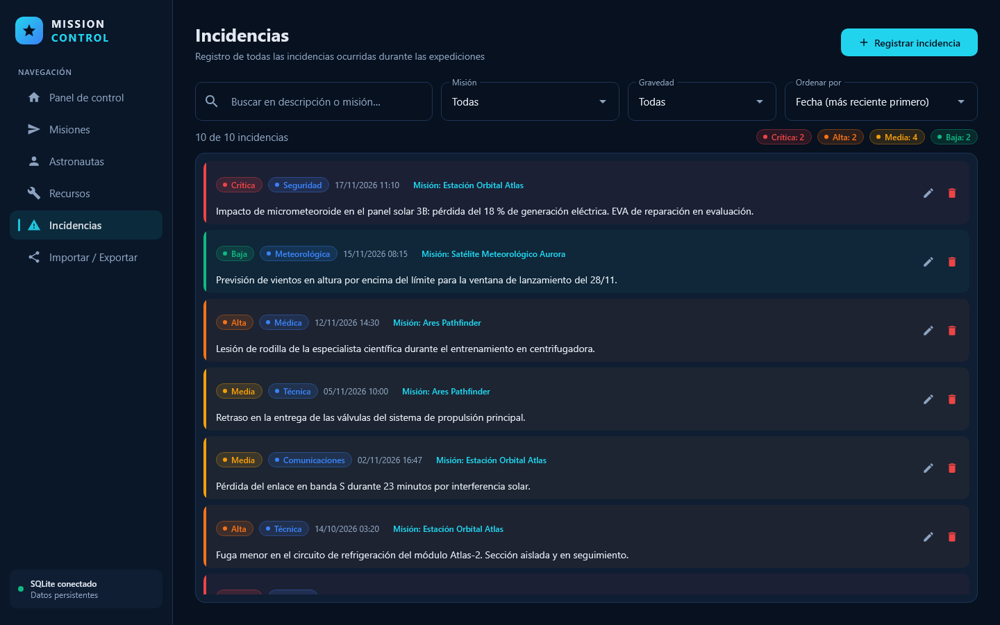
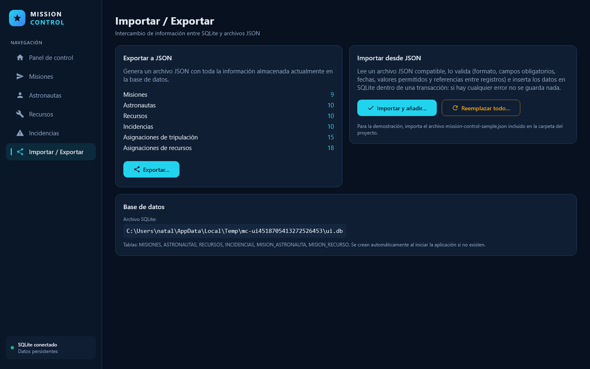

# Mission Control

A desktop application for a space agency to plan and track its expeditions: missions, astronauts,
inventory, crew assignments, incidents and live operational statistics.

Built with **Kotlin** and **Compose Multiplatform for Desktop**, with all data stored persistently in
**SQLite** and full **JSON** import/export.



> Academic project: *Programación multimedia y dispositivos móviles*, Activity 3 (MEDAC).
> The user interface and stored values are in Spanish, as required by the assignment.

---

## Features

**Dashboard**, computed live from the database
- Total, active (in preparation or in progress) and completed missions
- Available astronauts and registered incidents
- Next planned mission with a launch countdown
- Mission status breakdown and latest incidents
- Automatic alerts: critical incidents in open missions, missions without crew, unavailable
  astronauts assigned to a mission, overdue launch dates, and out-of-stock or low-stock resources

**Missions**
- Create, view, edit (the form loads the current values) and delete with confirmation
- Detail screen with all mission data, crew, assigned resources and incidents
- Search by name, destination or description (case- and accent-insensitive)
- Status and priority filters that can be combined
- Sort by date, name, priority, status or duration

**Astronauts**
- Full CRUD with search (by name or specialty) and an availability filter
- Detail screen with current status and every mission they are in or have been in, with their role

**Crew assignment** (many-to-many)
- Assign several astronauts to a mission, storing each astronaut's role
- Remove an astronaut from a mission without deleting them from the system

**Resources and inventory**
- Create, edit (including the available quantity) and delete resources
- Assign resources to missions; assigning more than the available stock is rejected
- Stock is updated in a database transaction; releasing a resource or deleting a mission returns it
- Out-of-stock and low-stock indicators

**Incidents**
- Create, edit and delete incidents with mission, date and time, type, severity and description
- Incidents can only belong to an existing mission (validation plus a foreign key)
- Shown in each mission's detail and in a global section, sortable by date or severity
- Severity is colour-coded (low, medium, high, critical)

**JSON import and export**
- Export the real database content (all entities and their relationships) to a JSON file
- Import: read → deserialize → validate (format, required fields, dates, allowed values, duplicate
  ids, cross-references) → insert in a **single transaction**. Invalid files are rejected with a
  clear message and nothing is written.
- Two modes: *add* to existing data, or *replace everything* (with confirmation)
- File ids are local references: new database ids are generated and every relationship is remapped

**User experience**
- Sidebar navigation, detail screens with back navigation
- Validated forms (no incomplete or invalid records), confirmation dialogs before deleting
- Success and error messages, and an empty state on every screen

---

## Screenshots

These are rendered from the real application with `mission-control-sample.json` imported
(generated by `UiFlowTest.renderScreenshotsWithSampleData`).

| Missions | Mission detail |
|---|---|
|  |  |

| Astronauts | Resources |
|---|---|
|  |  |

| Incidents | Import / Export |
|---|---|
|  |  |

---

## Technologies

| Technology | Purpose |
|---|---|
| Kotlin 2.4 | Language |
| Compose Multiplatform 1.12 (Desktop/JVM) + Material 3 | User interface |
| SQLite via `org.xerial:sqlite-jdbc` | Persistent storage |
| kotlinx.serialization (JSON) | Import and export |
| Gradle (Kotlin DSL, version catalog) | Build |
| kotlin-test + Compose UI Test | Data-layer and UI tests |

---

## Architecture

A small layered design: UI → state → repository → SQLite, with no framework beyond Compose.

```
desktopApp/src/main/kotlin/.../main.kt     Entry point: opens the database and the window
shared/src/jvmMain/kotlin/.../
├── App.kt                                 Shell: sidebar, screen routing, snackbar messages
├── AppState.kt                            Navigation, messages and a data-version counter that
│                                          refreshes every screen after each write
├── data/
│   ├── Models.kt                          Domain models, enums, date and search helpers
│   ├── Database.kt                        SQLite connection, schema creation, transactions
│   ├── Repository.kt                      SQL queries, business rules and validation
│   └── JsonService.kt                     JSON DTOs, export, validated transactional import
└── ui/                                    Screens, forms/dialogs, reusable components, theme
shared/src/jvmTest/kotlin/.../
├── DataLayerTest.kt                       Repository, persistence and JSON tests
└── UiFlowTest.kt                          Headless UI tests that drive the real screens
mission-control-sample.json                Demo data (never loaded automatically)
```

- The project uses the Kotlin Multiplatform template, but only the desktop (JVM) target is built.
  Because the SQLite driver is JVM-only, the application code lives in `shared/src/jvmMain`.
- Searching, filtering and sorting run in SQL. A custom `norm()` SQL function makes searches
  case- and accent-insensitive.

### Database

The database is created automatically on first launch, **with every table empty**:

```
~/.missioncontrol/missioncontrol.db     (Windows: C:\Users\<user>\.missioncontrol\missioncontrol.db)
```

It lives outside the project folder, so data survives restarts and a populated database is never
shipped with the source. The exact path is shown on the *Importar / Exportar* screen. Set the
`MISSIONCONTROL_DB` environment variable to use a different file.

| Table | Columns |
|---|---|
| `MISIONES` | id, nombre, destino, fecha, duracion, estado, prioridad, descripcion |
| `ASTRONAUTAS` | id, nombre, especialidad, experiencia, estado |
| `RECURSOS` | id, nombre, categoria, cantidad (available), unidad |
| `INCIDENCIAS` | id, mision_id → MISIONES, fecha, tipo, gravedad, descripcion |
| `MISION_ASTRONAUTA` | mision_id → MISIONES, astronauta_id → ASTRONAUTAS, rol |
| `MISION_RECURSO` | mision_id → MISIONES, recurso_id → RECURSOS, cantidad |

- Primary keys, foreign keys (`PRAGMA foreign_keys = ON`) and `CHECK` constraints on every enum column
- Deleting a mission cascades to its incidents and crew links; its resources go back to inventory
- A resource that is still assigned to a mission cannot be deleted
- Resource assignments and JSON imports run inside transactions

Enum values stored in the database and in JSON:

| Field | Values |
|---|---|
| Mission status | `PLANIFICADA`, `PREPARACION`, `EN_CURSO`, `COMPLETADA`, `CANCELADA` |
| Mission priority | `BAJA`, `MEDIA`, `ALTA`, `CRITICA` |
| Specialty | `PILOTO`, `INGENIERIA`, `MEDICINA`, `CIENCIA`, `COMUNICACIONES` |
| Astronaut status | `DISPONIBLE`, `EN_MISION`, `NO_DISPONIBLE` |
| Incident severity | `BAJA`, `MEDIA`, `ALTA`, `CRITICA` |

---

## Getting started

### Requirements
- IntelliJ IDEA (recommended), or JDK 17+ on `JAVA_HOME` to use the command line
- Internet access on the first build, so Gradle can download dependencies

### Run from IntelliJ IDEA
1. **File → Open…** and select the project folder (the one containing `settings.gradle.kts`).
2. Wait for the Gradle sync to finish.
3. Open `desktopApp/src/main/kotlin/com/cineflow/missioncontrol/main.kt` and click ▶ next to `main`,
   or run the Gradle task **desktopApp → Tasks → compose desktop → run**.

### Run from the command line
```bash
./gradlew :desktopApp:run
```
On Windows, use `gradlew.bat :desktopApp:run`.

### Load the demo data
The app starts with an empty database. To explore it with realistic data, go to
**Importar / Exportar → Importar y añadir…** and select
[`mission-control-sample.json`](mission-control-sample.json): 9 missions, 10 astronauts, 10 resources,
10 incidents, plus crew and resource assignments.

### Build and test
```bash
./gradlew build
```
`build` compiles everything and runs all tests. Use `./gradlew :shared:jvmTest` to run only the tests.

All tests use temporary databases and never touch the real one:
- **DataLayerTest** (9 tests): empty schema on first launch, CRUD, search and combined filters,
  inventory rules, crew and incidents, persistence after reopening the database, strict date
  validation, JSON round-trip and rejection of invalid files.
- **UiFlowTest** (3 tests): empty states on every screen. A full mission lifecycle through the real
  forms and dialogs: validation, create, search, edit, crew, resources (including over-assignment),
  incidents, removal and confirmed deletion. Also the screenshot rendering above.
